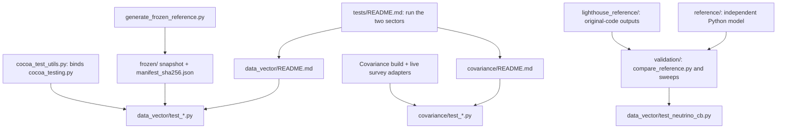

# Tests

The DES cluster tests and optional studies are organized as follows.

- [Data-vector and likelihood checks](data_vector/README.md) cover the project
  predictions, frozen inputs and numerical diagnostics.
- [Covariance checks](covariance/README.md) cover forecast assembly and its
  documented component checks. Covariance generation must be compiled.
- <a name="optional_studies"></a>[Optional studies](studies/README.md#optional_studies)
  compare n(z) reconstructions and numerical accuracy, with plots and
  $\Delta\chi^2$ results. Run them separately from the routine tests.



Read this page first, then the guide of the sector to run. The data-vector
tests read the frozen snapshot, which `generate_frozen_reference.py` writes
and `manifest_sha256.json` protects, through the shared machinery that
`cocoa_test_utils.py` binds; the exception is `test_neutrino_cb.py`, which
builds its state from the live likelihood and dataset through
`validation/compare_reference.py` and the `reference/` modules. The
covariance tests need the covariance build and read the live survey
adapters in `covariance/`. pytest does not collect `reference/`,
`validation/` and `lighthouse_reference/` by default; the
[validation tools section](#des_cluster_validation) describes these
validation tools.

These steps assume Cocoa and this project are installed, the Cocoa Conda environment
is active, the shell is Bash, and the current folder is `cocoa/Cocoa/`.

Run the sectors in separate Python invocations: they initialize different
compiled-library state. Running one project at a time also avoids importing
another project's same-named test helpers.

**Step :one:**: activate Cocoa.

```bash
source start_cocoa.sh
```

**Step :two:**: run the data-vector sector.

```bash
python -m pytest ./projects/des_cluster/tests/data_vector
```

**Step :three:**: enable covariance generation.

```bash
unset IGNORE_COSMOLIKE_DES_CLUSTER_COVARIANCE
```

**Step :four:**: compile the project.

```bash
source ./projects/des_cluster/scripts/compile_des_cluster.sh
```

**Step :five:**: run the covariance sector.

```bash
python -m pytest ./projects/des_cluster/tests/covariance
```

The project must be enabled in `set_installation_options.sh` before
activation. A covariance skip in a deliberately disabled build is expected;
it is not a successful covariance check. Read the sector guide to distinguish
asserted regressions from advisory accuracy reports.

Frozen configurations and inputs are protected by `manifest_sha256.json`.
Do not regenerate references to silence an unexplained failure. The
[data-vector guide](data_vector/README.md#refreeze) documents the deliberate
reference-update procedure and its limits; the covariance sector stores no
reference values.

Hybrid examples can be checked without sampling:

**Step :one:**: check configuration 1.

```bash
python ./projects/des_cluster/EXAMPLE_EMUL2_MINIMIZE1.py --check
```

**Step :two:**: check configuration 2.

```bash
python ./projects/des_cluster/EXAMPLE_EMUL2_MINIMIZE2.py --check
```

## Validation tools <a name="des_cluster_validation"></a>

An unqualified pytest run collects only `tests/data_vector`, and pytest never descends into the three validation folders below; each is run on its own.

- `tests/reference/` holds an independent Python reference model of the cluster observables and of the joint Gaussian covariance, with its own tests:

      python -m pytest ./projects/des_cluster/tests/reference

- `tests/validation/compare_reference.py` compares the compiled code with the Python reference, quantity by quantity (selection kernels, number density and bias per richness bin, one-halo power spectrum, counts, Limber spectra, real-space statistics, and the cluster blocks of the data vector), and checks that the data vector is bitwise identical at 1 and 8 OpenMP threads:

      python ./projects/des_cluster/tests/validation/compare_reference.py --threads 4

  [PORT_PLAN.md](../PORT_PLAN.md) records the result: every cluster quantity matches the reference to $2\times10^{-5}$ or better, except cluster lensing, which differs by $10^{-3}$ in the tail of the lowest source bins behind the highest cluster bin; on the cluster-lensing block this amounts to $\Delta\chi^2 = 3.4\times10^{-5}$ with the scale cuts and $2.0\times10^{-4}$ without them.

- `tests/validation/knob_sweep.py` measures the accuracy settings one at a time with the small scales visible. It reuses the cache of `compare_reference.py`:

      OMP_NUM_THREADS=4 python ./projects/des_cluster/tests/validation/knob_sweep.py \
        --cache-dir <compare_reference cache> --cov ./projects/des_cluster/data/des_cluster_y6_cov.npy

- `tests/lighthouse_reference/` holds data vectors and intermediate quantities computed with the original CosmoLike cluster code (the `lighthouse` repository), kept for comparison. Its [README](lighthouse_reference/README.md) documents the configuration and lists where that code deviates from the model of the paper. The port follows the paper, apart from the choices documented in the [project README](../README.md) (the volume-only cluster kernel by default, the cluster-lensing pairs kept and masked, Limber-only $w_{cc}$ and $w_{cg}$), so this comparison is a sanity check at the percent level: `compare_reference.py` measures counts that agree to 2.4% and a cluster bias that agrees to 0.8% ([PORT_PLAN.md](../PORT_PLAN.md), section 7; the original code integrates with a relative tolerance of $10^{-2}$).

## Timing <a name="des_cluster_timing"></a>

`tests/validation/time_cosmolike.py` times the data vector per probe set: after one warm-up, every timed evaluation moves every sampled parameter, so no table is served from a cache, and the timer of the likelihood is read apart from the timer of CAMB.

    OMP_NUM_THREADS=8 OPENBLAS_NUM_THREADS=1 VECLIB_MAXIMUM_THREADS=1 \
      python ./projects/des_cluster/tests/validation/time_cosmolike.py

`tests/validation/time_lighthouse.py` times the original CosmoLike cluster code in the same way; it needs the prebuilt library of that code, which is not part of Cocoa.

Published timings are maintained in
[Cocoa's main README](https://github.com/CosmoLike/cocoa#overview).
[PORT_PLAN.md](../PORT_PLAN.md) retains the historical port measurements.
