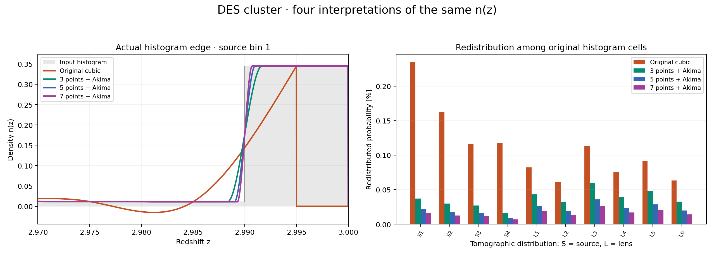

# DES cluster: optional n(z) reconstruction study

## :interrobang: FAQ: What are optional studies? <a name="optional_studies"></a>

Optional studies explore how numerical settings and modeling choices
affect predictions; they can be expensive, so they run separately from
the routine tests. The shared guide to this n(z) reconstruction study -
the reconstruction definitions, the distance metric, the area
accounting, the figure construction and the run options - is
[The n(z) reconstruction study](https://github.com/CosmoLike/cocoa-cosmolike-core/blob/main/cosmolike_notebook_utils/README.md#nz_study)
in the CosmoLike core. This file records this survey's measurements.

For DES cluster, this switch acts on the galaxy source/lens histograms.
Its separately supplied cluster selection probabilities retain their linear
interpolation; they are not galaxy histogram densities.

## The survey figure



The illustrated DES cluster source histogram has a nonzero last cell. The
original midpoint curve stops at its final centre, producing the visible drop
to zero; the Akima preparation covers the full cell support. This endpoint
difference is part of the measured reconstruction, not a plotting artifact.
Here the final cell is [2.99, 3.00), its centre is 2.995, and its normalized
density is 0.344858. The original curve has total area 0.99802745 in this
source bin, a 0.1973% deficit; the reported area includes both endpoint loss
and interpolation effects throughout the histogram.

## Measured model-vector distances

All four arms use the stored NLA example point, this survey's histogram
files, mask and supplied covariance, at the shared study settings
(`accuracyboost: 5`, `integration_accuracy: 7`); the distance is the
guide's $`\Delta\chi^2`$, judged against practical stability at 0.2.

| Original → 3 | 3 → 5 | 3 → 7 | 5 → 7 |
|---:|---:|---:|---:|
| 0.3804323 | 0.00781692 | 0.01416825 | 0.002362326 |

Original at its YAML defaults (`accuracyboost: 1`,
`integration_accuracy: 1`) versus the refined study settings:
**Δχ² = 0.024920297** - numerical accuracy alone, without changing the
histogram interpretation.

## Measured area accounting

| Reconstruction | Total-area range | Largest redistributed fraction |
|---|---:|---:|
| Original cubic | 0.998027446–1.00000022 | 0.234395% |
| 3-point Akima | 1–1 | 0.0599728% |
| 5-point Akima | 1–1 | 0.0359837% |
| 7-point Akima | 1–1 | 0.0257026% |

## Run the study <a name="run_study"></a>

The environment setup, stage selection and accuracy options are in the
shared guide ([Run the study](https://github.com/CosmoLike/cocoa-cosmolike-core/blob/main/cosmolike_notebook_utils/README.md#nz_run)). For this survey, from
`cocoa/Cocoa/` with the cocoa environment active:

```bash
python -m pytest projects/des_cluster/tests/studies/study_nz_reconstruction.py -v -s
```

or, keeping the results in a chosen folder:

```bash
python projects/des_cluster/tests/studies/run_nz_reconstruction.py --output <folder>
```

To redraw the committed figure without a cosmology calculation:

```bash
python projects/des_cluster/tests/studies/generate_nz_reconstruction_figures.py
```

[Comparison record](results/comparison.json), [default settings](results/defaults.json),
[refined settings and input fingerprints](results/refined.json),
[area audit](results/probability.json), and their adjacent NPZ arrays preserve
the measurements. The inverse covariance is stored once through Git LFS.

